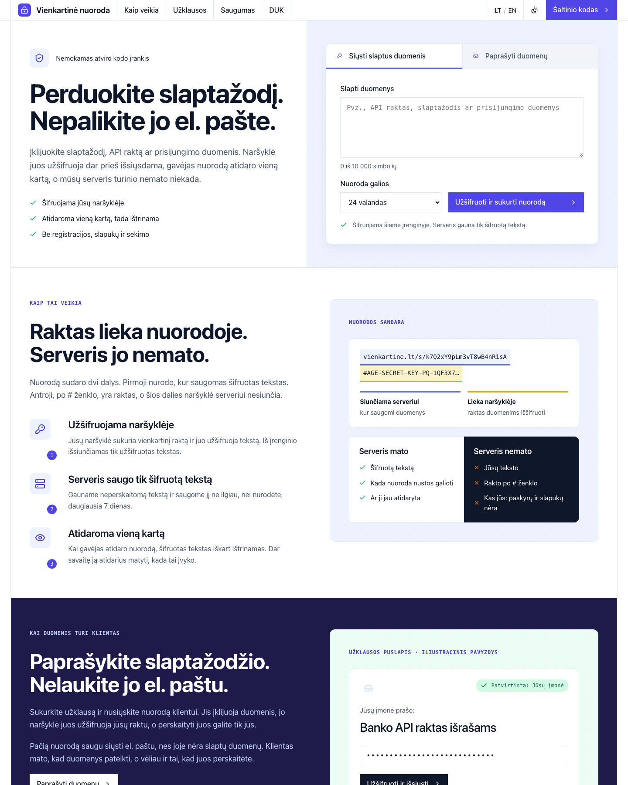
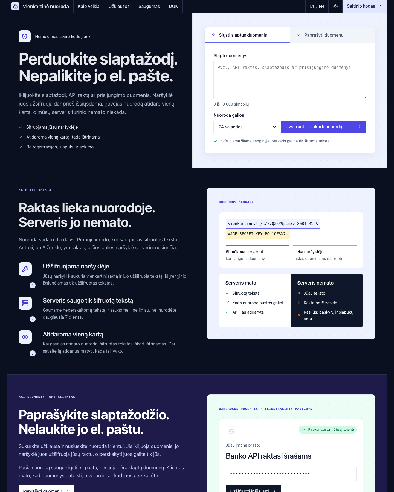

# Areza Secret: one-time secret links

[](https://github.com/areza-digital/one-time-secret-link/actions/workflows/ci.yml)

Areza Secret is a small web app and command-line tool for handing over a password or an API key without leaving it in
an inbox or a chat log. On the Lithuanian pages of the hosted instance it is called **Vienkartinė nuoroda** ("one-time
link"), which is where the CLI (`vienkartine`) and its `VIENKARTINE_*` variables get their name. The repository was
called `vienkartine` until November 2026; old links redirect.

The text is encrypted in the browser with [age](https://age-encryption.org) using post-quantum hybrid keys
(ML-KEM-768 + X25519). The server stores only ciphertext and deletes it on the first read or at expiry (1 hour to
7 days). It runs on Cloudflare Workers and Durable Objects, has no accounts and no cookies, and is MIT licensed.

The default theme, in light and dark mode:

| Light | Dark |
|---|---|
|  |  |

**Hosted instance:** https://secret.areza.digital, run by Areza Digital
(AI Merge Studio Ltd). It is free to use. You can also run your own: see [Quick start](#quick-start).

The pages are in Lithuanian and English (English under `/en`).

## What it does

**One-time links.** Paste a secret, get a link such as `https://host/s/<id>#<key>`. The key sits after the `#`, the
URL fragment, which browsers do not send to the server. Opening the page does not use the link up: the reader has to
click Show, and only then does the server hand over the ciphertext and delete it. Afterwards anyone who tries the link
sees when it was opened.

**Request links.** Ask someone else for a secret. You create a request, and your browser (or the CLI) keeps the private
key. The server stores only the public key and a short label. The resulting `/r/<id>` link holds no secret, so it is
safe to send by email. The sender's browser encrypts the answer to your public key, and only you can read it, in the
browser at `/o/<id>#<key>` or with `vienkartine pull`. If someone other than the intended person answered first, you
can reject the answer and the same link accepts a new one.

## How it works

```
https://host/s/k7Q2xY9pLm3vT8wB4nR1sA#AGE-SECRET-KEY-PQ-1QF3X7...
└────── sent to the server ──────────┘└── stays in the browser ──┘
```

One-time link:

1. The sender's browser generates a fresh age identity (`AGE-SECRET-KEY-PQ-1...`) and encrypts the text to its
   recipient (`age1pq1...`). Only the armored ciphertext is uploaded, together with an auth token.
2. The link is `/s/<id>#<identity>`. The auth token is `base64url(SHA-256("vienkartine/v1/auth\n" + identity))`;
   the server stores only `SHA-256(auth)`.
3. The recipient opens the link. The page fetches metadata only. On Show it calls `POST /api/items/:id/open`; the
   Durable Object that holds the item returns the ciphertext and removes it in the same step. The browser decrypts
   locally with the key from the fragment and then removes the key from the address bar.
4. Each item is one Durable Object, which handles one request at a time, so a second open cannot succeed.

Request link:

1. The requester's browser or CLI generates the identity and uploads only the recipient key, the label and the auth
   token. Only post-quantum recipients (`age1pq1...`) are accepted.
2. The sender opens `/r/<id>`, encrypts to the recipient and calls `POST /api/items/:id/fill`. Only the first answer
   is accepted.
3. The requester reads the answer with the identity (`/o/<id>#<identity>` or the CLI). Reading deletes the ciphertext
   and leaves a receipt (see the limits table).

Limits:

| What | Limit |
|---|---|
| Text | 10,000 characters |
| Ciphertext | 48 KiB (49,152 bytes) |
| Request label | 140 characters |
| Lifetime | 1 hour to 7 days |
| "Opened at T" receipt after a read | kept 7 days, without the ciphertext |

There are no file uploads and no accounts.

## Security

Report vulnerabilities privately, as described in [SECURITY.md](SECURITY.md): through GitHub's private vulnerability
reporting, or by email to hello@areza.digital (the route that works today). Please do not open a public issue.

The code was reviewed and penetration-tested before 0.2.0 and checked again on 2026-10-22 (dependency audit, Semgrep,
gitleaks, TruffleHog and a manual review). Every finding and its status is in
[docs/security-reviews.md](docs/security-reviews.md), and what the 2026-10-22 check covered is in
[SECURITY.md](SECURITY.md#latest-check-2026-10-22). These are the project's own reviews, not an independent audit.

In short:

- The server never receives the plaintext or the age identity. It stores ciphertext, hashes of the tokens, the public
  recipient key and label of a request, and timestamps.
- The CSP is `default-src 'none'; script-src 'self'; style-src 'self'; connect-src 'self'` and more, with
  `require-trusted-types-for 'script'`. All scripts and the stylesheet carry Subresource Integrity (sha384). There are
  no third-party scripts, fonts, analytics or cookies. Other headers: `Referrer-Policy: no-referrer`, HSTS,
  `Cross-Origin-Opener-Policy`, `Cross-Origin-Resource-Policy`, `nosniff`, `X-Frame-Options: DENY`.
- Per-IP and global rate limits protect the service. IP addresses are hashed with a daily salt (IPv6 per /64) and
  never stored raw. Workers Logs are off in the shipped configuration.
- Anonymous request labels are filtered against spoofing and shown as a quoted message under a warning, never as the
  page headline.

Known limits, stated plainly:

- **Whoever controls the deployment controls the JavaScript the page runs.** Open source and
  [`bun run verify`](#verifying-a-deployment) make tampering detectable by people who check; they do not make it
  impossible. The same goes for the HTML and the stylesheet, which a theme controls and `verify` does not check: CSS
  alone can leak a key that sits in a link on the page.
- For request links, a malicious server could hand the sender its own public key. This has the same root cause.
  One-time links are not affected by this particular attack, because the server never learns their key.
- Whoever gets a one-time link first can open it. The real recipient then sees that it was already opened.
- Cloudflare account holders can restore deleted Durable Object data for up to 30 days. Deleted ciphertext is useless
  without the key, but a link kept in a mailbox or chat is that key.
- On the Workers free plan, a distributed attacker can exhaust the daily quotas. Public instances should use Workers
  Paid.

The full analysis (assets, actors, mitigations, limits, operator checklist) is in
[docs/threat-model.md](docs/threat-model.md). Reports of vulnerabilities go through [SECURITY.md](SECURITY.md).
The internal code review and penetration test run before release, and the status of every finding, are in
[docs/security-reviews.md](docs/security-reviews.md).

## Quick start

### Use the hosted instance

Open https://secret.areza.digital. The CLI below talks to it by default.

### Self-host on Cloudflare

[](https://deploy.workers.cloudflare.com/?url=https://github.com/areza-digital/one-time-secret-link)

The button flow prompts for the secrets listed in `.dev.vars.example`. Afterwards set the instance's name, domain and
contact address, add a custom domain and adjust a few Cloudflare zone settings. Do this before you point people at
it. The step-by-step guide, including the manual route with `wrangler`, is [docs/self-hosting.md](docs/self-hosting.md).

The manual route in short (needs [Bun](https://bun.sh) 1.4.2 and a Cloudflare account):

```bash
git clone https://github.com/areza-digital/one-time-secret-link && cd one-time-secret-link
bun install
bunx wrangler login
VK_ORIGIN=https://secret.example.com VK_PRODUCT="Our secrets" VK_CONTACT=abuse@example.com bun run deploy
openssl rand -base64 32 | bunx wrangler secret put IP_SALT
```

`IP_SALT` is required: without it the API refuses anonymous requests. Edit `wrangler.jsonc` first if you want a
different Worker name or indexing setting (see the guide).

### Run it locally

```bash
bun install
cp .dev.vars.example .dev.vars   # set IP_SALT (openssl rand -base64 32)
bun run dev                      # build + wrangler dev on http://127.0.0.1:8787
```

## CLI

`cli/vienkartine.ts` runs on Bun (the [Claude Code plugin](#use-it-from-claude-code) ships it bundled, for Node 20.19 or
later). Run it with the flags below, or `chmod +x` it and run it directly (its shebang carries
the same flags):

```bash
bun --no-env-file --config=/dev/null cli/vienkartine.ts <command>
```

The flags matter. Without them Bun loads `.env` and `bunfig.toml` from the current directory, so a file planted in a
cloned repository could point the CLI at another server or run code before it starts.

| Command | What it does |
|---|---|
| `request "<label>" [--env NAME --to FILE \| --raw FILE] [--ttl 7d] [--lang lt\|en]` | Creates a request link for someone else to answer. The private key stays in `VIENKARTINE_HOME`. Prints the link for the sender. |
| `pull <id> [--wait] [--timeout 1h]` | Decrypts the answer straight into an env file or a raw file (mode 0600). Prints only the name, the length and the answer time. |
| `reject <id>` | Discards a wrong or foreign answer. The same link accepts a new one. |
| `send [--file F \| --from-env FILE:NAME \| stdin] [--ttl 24h] [--lang lt\|en] [--out FILE \| --print]` | Creates a one-time link. By default it goes to the clipboard (`pbcopy`, so macOS) and is not printed; use `--out` or `--print` elsewhere. |
| `open [--env NAME --to FILE \| --raw FILE]` | Uses up a one-time link. Pipe the link on stdin: a link passed as an argument ends up in shell history. Only links on the configured instance are accepted. |
| `status [id]` | Shows the server state of everything created from this machine. |
| `revoke <id> [--admin]` | Deletes a request or one-time link now. `--admin` takes down anyone's link and needs the operator token. |
| `push --from FILE --env NAME --ssh HOST --remote PATH` | Copies one variable into a remote env file over ssh. The value travels on stdin only. |

In the examples below, `vienkartine` stands for the command above (for instance a shell alias).

```bash
vienkartine request "Anthropic API key" --env ANTHROPIC_API_KEY --to ~/.config/client/x.env --lang en
vienkartine pull <id> --wait
pbpaste | vienkartine open --env NAME --to FILE
vienkartine send --from-env .env:DATABASE_URL
```

Behavior worth knowing:

- Secrets are never printed. Files are written atomically with mode 0600. When `pull` or `open` replaces an existing
  value in an env file, the previous file is kept as `<file>.vienkartine.bak`.
- The save target is checked before the secret is opened. If saving still fails afterwards, the value is written to
  `VIENKARTINE_HOME/recovered/<id>.txt` (mode 0600) so that it is not lost; delete it after you have moved the value.
- Values containing `'`, `$`, a line break or a control character cannot go into an env file safely and must be
  saved with `--raw FILE`.
- `request` stores the private key of each pending request in `VIENKARTINE_HOME/requests/`, and `send` stores a manage
  token in `VIENKARTINE_HOME/sent/`. These files are plaintext (mode 0600) until the item expires or `status` finds it
  gone.
- The CLI talks only to `https://` URLs (or `localhost` and `127.0.0.1`), refuses redirects, and refuses links that are
  not on the configured instance.

Environment:

| Variable | Default | Meaning |
|---|---|---|
| `VIENKARTINE_URL` | `https://secret.areza.digital` | Instance to use |
| `VIENKARTINE_HOME` | `~/.config/vienkartine` | Local state |
| `VIENKARTINE_OPERATOR_TOKEN`, `VIENKARTINE_OPERATOR_URL` | none | Operator token and the instance it belongs to. Can also live in `VIENKARTINE_HOME/operator.env`. The token is sent only to that URL. |

Exit codes: 2 not filled yet, 3 not found or expired, 4 wrong key, 5 already used, 6 rate limited, 7 not saved as asked.

## Use it from Claude Code

A Claude Code plugin lets you hand an API key or a password to your coding assistant without it passing through the
chat. It uses only the request flow described above. Install it from a shell:

```bash
claude plugin marketplace add areza-digital/one-time-secret-link
claude plugin install vienkartine@areza-secret
```

You need Claude Code and Node.js 20.19 or later (the plugin's command is a bundle that runs on Node; no Bun needed).
The plugin adds one skill, `request-secret` (`/vienkartine:request-secret`), and puts the `vienkartine` command on the
`PATH` of the assistant's shell. It has no hooks, no servers and no background processes.

**What happens when the assistant needs a credential**

1. It runs `vienkartine request "..." --env NAME --to FILE`, which prints a request link. The file is outside your
   project, by default `~/.config/vienkartine/secrets/NAME.env`.
2. It gives you the link. If someone else holds the secret, you send them the link (it holds no secret, so it is safe
   to email).
3. You open the link in your own browser and type the secret into the page. It is encrypted there, to a key that
   exists only on your machine.
4. You tell the assistant. It runs `vienkartine pull <id>`, which writes the value to the file (mode 0600) and prints
   only the variable name and its length.
5. From then on the assistant uses the variable by name, in the shell command that needs it, for example by sourcing the
   file in that same command.

**The rules the skill gives the assistant.** It never asks for the secret in the chat. It never puts a secret on a
command line, never prints it (no `cat`, `echo`, `env`, `set -x`, `curl -v`) and never reads the file back with a tool.
It never reads `~/.config/vienkartine/`, where the private keys of pending requests and recovery files live. It uses
only `request`, `pull`, `status`, `reject` and `revoke`, never `send`, `open` or `push`: those handle secrets the
assistant should not hold, and `send --print` is the one command that prints a link that unlocks a secret. For
passwords, PEM or JSON keys, and anything with a `$`, a quote or a line break, it asks for a raw file (`--raw`), because
an env file cannot hold those.

**What this protects, and what it does not.** Claude Code's documentation says: "Transcripts and history are not
encrypted at rest." Anything that passes through a tool or the chat is written there, as plaintext. The point of the
plugin is that the secret never passes through either: you type it into a web page, and the only things the assistant's
tools print are the variable name and its length. It cannot promise more than that:

- A skill is an instruction, not a lock. Nothing technical stops an assistant that ignores it, or one that was
  manipulated by text it read, from running `cat` on the file. A command that echoes the variable, or an error message
  that contains it, puts it into the transcript. Every program the assistant runs with the variable can read it, as you.
- The file and the pending requests' private keys sit on your disk as plaintext (mode 0600), readable by anything that
  runs as you. Deleting the file after use is on you.
- The web page is served by the instance's operator. By default that is Areza Digital at https://secret.areza.digital;
  whoever runs an instance controls the JavaScript it serves (see [Known limits](#security)). To use your own, set
  `VIENKARTINE_URL`, either in your shell or for every session in Claude Code's settings:
  `{ "env": { "VIENKARTINE_URL": "https://secret.example.com" } }` in `~/.claude/settings.json`. The skill tells the
  assistant to say which host the link points to.
- A Claude Code plugin runs code as you. This one has no hooks or servers, and its only code is `bin/vienkartine`,
  the bundle of `cli/vienkartine.ts` with `age-encryption` (unminified, so it can be read). `bun run build:plugin`
  rebuilds it byte for byte, and a test fails when it differs from the source.
- It works in Claude Code only: claude.ai and Cowork do not install plugins that have a `bin/` folder.

Worth adding yourself: deny the file tools the folders that must never be read, in your user settings (the rule syntax
is Claude Code's, see its permissions page):

```json
{ "permissions": { "deny": ["Read(~/.config/vienkartine/requests/**)", "Read(~/.config/vienkartine/recovered/**)", "Read(~/.config/vienkartine/secrets/**)"] } }
```

Per the same documentation, such rules cover Claude's file tools and the file commands it recognises in Bash (`cat`,
`head` and similar), not a program that opens the file itself. Whether the third rule also stops a shell from sourcing
a secrets file in the same command was not checked; if it does, leave that rule out. Setting `cleanupPeriodDays` lower
shortens how long transcripts are kept.

How the plugin is built, how to try it without touching your own Claude Code setup, and what submitting it to
Anthropic's directory would need: [docs/claude-code-plugin.md](docs/claude-code-plugin.md).

## Theming

The look and the words of an instance come from a theme: a folder whose `theme.ts` default-exports a `Theme`. The
default theme (`themes/default`) uses system fonts and [Lucide](https://lucide.dev) icons and reads `VK_ORIGIN`,
`VK_PRODUCT`, `VK_REPO` and `VK_CONTACT`. Point `VK_THEME` at your own folder to replace it. Themes change HTML and
CSS, never the JavaScript, so verification works for every instance. See [docs/theming.md](docs/theming.md).

The hosted instance uses a private Areza theme. Its fonts are licensed for self-hosting only, and it carries the Areza
logo and artwork, so that theme is not part of this repository. A theme can name the product differently per language,
as the hosted instance does (`product: { lt: "Vienkartinė nuoroda", en: "Areza Secret" }`).

## Verifying a deployment

Every page carries `<meta name="vk-version">` and `<meta name="vk-commit">`, and shows both in the footer. To check
that an instance serves the JavaScript of that commit:

```bash
git clone https://github.com/areza-digital/one-time-secret-link && cd one-time-secret-link
git checkout <commit from the footer>
bun install
bun run verify https://secret.areza.digital
```

The script rebuilds the JavaScript and compares it byte for byte with what the site serves, checks the Subresource
Integrity values, checks that the Content-Security-Policy allows only same-origin scripts, and checks that no page references a
script outside `/assets/`. It checks both landing pages and the six pages that open links and requests (`/s`, `/r`, `/o`
and their `/en` versions). Use the same Bun version as `package.json` (`bun@1.4.2`); the script warns if it differs.
It is a point-in-time check of the JavaScript only, not of the HTML or the stylesheet. What it does not cover is listed
in [docs/threat-model.md](docs/threat-model.md#what-bun-run-verify-checks).

## Development

```bash
bun install
bun run dev        # build + wrangler dev (needs .dev.vars)
bun run check      # typecheck + unit tests + end-to-end tests
bun run build      # writes dist/
bun run build:plugin   # rebuilds the Claude Code plugin's command, plugins/vienkartine/bin/vienkartine
bun run verify <url>
bun run deploy     # build + tests + wrangler deploy (needs wrangler login)
bun run scripts/shoot.ts <url> <dir> [paths]   # screenshots at phone and desktop widths, with an overflow check
```

`bun run check` runs `tsc` for the browser/CLI and Worker code, `bun test`, and an end-to-end run that starts its own
`wrangler dev` with throwaway storage and secrets. `scripts/shoot.ts` expects Google Chrome at its macOS path.

| Path | What |
|---|---|
| `src/worker/` | Cloudflare Worker: API, page routing, security headers; `SecretBox` (one Durable Object per item) and `RateLimiter` |
| `src/shared/` | Wire protocol, label rules and the age wrapper, shared by Worker, browser and CLI |
| `src/web/` | Browser code (tool page, open, fill and owner pages) |
| `site/` | Static site generator: `copy.ts` (all Lithuanian and English text), `build.ts`, `base.css`, `theme.ts` (the Theme interface) |
| `themes/default/` | The default theme |
| `cli/` | The `vienkartine` CLI |
| `plugins/vienkartine/`, `.claude-plugin/` | The Claude Code plugin (skill, bundled command) and the marketplace file that lists it |
| `scripts/` | `e2e.ts`, `verify.ts`, `shoot.ts`, `build-plugin.ts` |
| `test/` | Unit tests |
| `docs/` | Threat model, self-hosting, theming, security reviews, design notes |

See [CONTRIBUTING.md](CONTRIBUTING.md) before opening a pull request.

## Documentation

- [Threat model](docs/threat-model.md)
- [Self-hosting](docs/self-hosting.md)
- [Theming](docs/theming.md)
- [Claude Code plugin](docs/claude-code-plugin.md)
- [Security reviews](docs/security-reviews.md) (with the original reports in `docs/reviews/`)
- [Security policy](SECURITY.md)
- [Changelog](CHANGELOG.md)

## Roadmap

A personal inbox: a permanent address that only its owner can read, with email-verified identity and per-device keys.
It is a design draft, not built: [docs/design/personal-inbox.md](docs/design/personal-inbox.md).

## Credits

- [age](https://age-encryption.org) by Filippo Valsorda and its TypeScript implementation
  [typage](https://github.com/FiloSottile/typage) (the `age-encryption` package) do all the cryptography. This
  project only chooses the key type and the armor.
- [Lucide](https://lucide.dev) icons in the default theme, under the ISC license (see
  `themes/default/ICONS-LICENSE`).
- Built on [Bun](https://bun.sh) and [Cloudflare Workers](https://workers.cloudflare.com).

## License

[MIT](LICENSE). Copyright (c) 2026 AI Merge Studio Ltd (Areza Digital).
